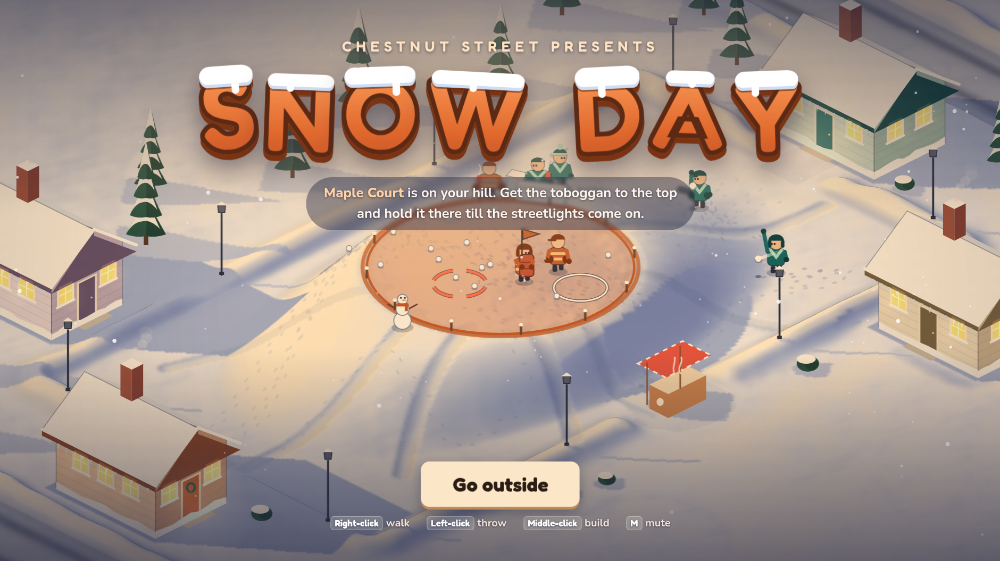

# Snow Day — Greybox Hill A



Phase 1 of the build order in `../idea-board.design.md`. Ruleset v4, implemented as written.

```sh
bun install
bun run dev              # http://localhost:5173 (play)
bun run botrun           # headless bot CSV + pass/fail gates -> out/botrun-seed1.csv
bun tools/botrun.ts --matches 40 --seed 2 --reaction 0.45
bun tools/botrun.ts --days 10     # whole snow days, gear carrying over: per-street reads + persistence gates
```

## Controls (three, as frozen)

| | Keyboard + mouse | Gamepad |
|---|---|---|
| Move | WASD / arrows, **or hold right-click** to walk toward the cursor | left stick |
| Aim / throw | mouse aims the ring, click throws (with the launcher: **hold** to spray) | right stick aims, **release** throws (hold RT to spray) |
| Handoff | click while carrying (only the outlined ally is legal; otherwise nothing happens) | same |
| Wall | Space / middle-click | A / LB |

Designer/QA keys (testers never need them): `` ` `` debug overlay · `L` download session CSV · `M` mute · `P` pause.

## URL params

- `?bots=1`: watch 8 bots (human slot = stand-in). Add `&speed=4` to fast-forward. Use this for Art's 1s clips and QA #15's 60s clip.
- `?street=2|3`: start on Ivy Terrace / The Summit Kids (reaction 0.50 / 0.45, siege volley 1.5s / 1.45s, rule 10 mixes)
- `?boss=1`: straight into Frosty's bout (then the title). `?boss=bot`: watch a stand-in play it.
- `?round=90`: round length in seconds (default 120). `bun tools/botrun.ts --round 90` for bot runs.
- `?seed=N`, `?reaction=0.5`
- `?kit=launcher,rock,melter,snowman`: start with garage gear (to try items without earning them). `?credits=30`: start with money.
- `?view=blockout&hill=B|park|A`: static blockouts for the 1s flank check. Keys `1/2/3` switch hill, `D` steps through dusk.

## What's in

The greybox list from the brief: untextured hill A, final fixed camera (1280×720, kids ~48px), 4 dusk steps, then streetlights flicker on at 120s, an exact countdown in the last 20s, sudden death (hold the crown 5s, capped at 60s), and the porch screen (grudge line + score; match end shows equal-weight `Next street` / `Finish snow day`). Also: wall ghost footprint (cooldown fill / ready / barred), synthesized temp audio (all seven sounds), and 8 bots (Beanie / Pockets / Brick / Copycat, plus Pip / Scoop / Waffle) under the fair-bot rule. Also plain snowballs plus Pockets' blower, committed rings, first-contact hits, the wall, the 3-street ladder, and blockouts of the away hill and the park.

**The garage (from the owner's brief, replacing the board's 3-card draft):** you earn ❄ credits: 1 per chill you land, 1 per 6 crown-seconds you carry, 1 per teammate you thaw, plus 4 per round (2 more for winning). You spend them between rounds, **one purchase per visit**. **Gear and unspent credits last the whole snow day** (all 3 streets), for every kid, bots included; only `New snow day` wipes everyone back to plain, and the notice "Fresh snow, fresh start — your gear and credits reset." sits under that button before you click. Owned items read "Owned — lasts this snow day" and are never priced again; when nothing on the shelf is affordable the garage leads with "Your gear is ready". Bot wishlists (rule 4): Beanie ice → launcher → rock, Pockets melter → snowman, Brick melter only, Copycat copies your last buy of the day, else ice → launcher. Bots never swap rock back to ice. Rival bots keep their slot's gear when the next street takes over the hill. Siege volleys are always bare plain rings plus the blower cappers, never a bot's purchases. Frosty's bout opens with a "Snowballs only — your gear waits in the garage" card and a plain snowball in your mitten. The CSV tags every row with `day` and `street`, logs one `garage` row per kid per visit (credits held, item or none, your seconds on screen), and splits chills by the item that did it (`card` on `chill` rows: launcher / plain / ice / rock / blower). The two-slot loadout (rule 4's named lever) is not built: it stays off until the persistence gate trips.

| Item | ❄ | What it does |
|---|---|---|
| Snowball launcher | 10 | Hold throw to spray small snowballs (15-ball hopper shown under your feet, refills when you pause, 2.5s reload if emptied). Fires your current snowball type. |
| Ice snowballs | 4 | Faster flat throws that shatter any wall they hit. |
| Rock snowballs | 8 | Smash through walls and snowmen and keep going; knock kids back 1.5m. Swaps with ice (one ball slot). |
| Snowball melter | 4 | Passive: rival walls and snowmen you touch melt; chilled teammates you reach thaw instantly (once every 6s). |
| Snowman | 8 | Your build button makes a snowman (one at a time, 12s cooldown) that throws at rivals within 8m. 3 hits to knock down; ice or rock in 1. |

Rounds are 120s (was 180). The clock is always visible under the score, with a daylight bar that burns down. It turns big and gold for the last 20s and ticks each second for the last 10. Dusk steps scale with the round length.

**Frosty's bout (bonus, after a match).** Press `Next street` / `New snow day` and Frosty wakes up on the crown. `Finish snow day` skips him. It's your kid alone, 60s, streetlights on, plain snowballs, no building.
- **To win:** land 10 hits to melt him. His throws (a lead ring, a direct ring and a lob) take one of your 3 mittens each: knockback, never the cocoa stand.
- **Specials at 15/30/45s:** a 0.5s mitten sweep sinks the two mounds and raises new ones, one of them 5–7m from you. Then a 2.5s snowflake swirl grows each half second, and a **Blizzard Burst** sends a gapless ring of snowballs every way. Anywhere outside the dashed safe zone behind a mound is an instant loss.
- **Double Blizzard:** once he's down to 5 hits, he fires two bursts 1.5s apart from the same cover. Stepping out between them to sneak a throw is the trap.
- **Dizzy:** he's dizzy for 2s after each special, so you get free throws.
- **Prize:** win and his pot hat sits beside Chestnut Street on the porch for the rest of the snow day. Losing costs nothing.

GREYBOX choices: in the bout your throw has a 0.45s wind-up (you're planted, and a hit cancels it) and a 2s scoop between balls. At the field's old 1.2s, ten throws would melt him in 12s, before his first special. His volleys come every 2.4s.

`bun tools/bossrun.ts` runs 200 bouts with a stand-in (hides on time, throws in his rhythm, reads rings at 0.45s). It currently melts him in 61% of bouts, spends a median of 2 mittens, and a bout lasts ~41s.

**The siege (Host playtest 1: "the crown is too safe").** The crown is now a flat 4m radius. When anyone carries the sled within 2m of its edge, the other team stops throwing on their own and fires ONE shared volley every 2.0s (street 1), 1.5s (street 2) or 1.45s (street 3), with every ring released on the same frame:
- throwers 8m+ out bracket you: one ring where you'll be if you keep walking, a second 1.2m to one side;
- a thrower closer than 8m takes one direct shot at where you stand;
- Pockets' blower lands ~1s later on the exit you'd naturally take (street 3 has two Pockets, so both ways);
- never more than 4 live siege rings; Brick never throws.

Standing still gets you chilled within a couple of seconds. Walking irregularly and stepping out of rings keeps you scoring, and handing off is the free escape. Chestnut's bots siege a rival carrier the same way. Rival throwers ring the carrier at ~9m and flank around walls for a clear line. Bot carriers walk irregularly on the crown and step out of rings they've seen (0.4s read). Bot runs log `siege`, `hold` and volley numbers; the gate table adds median crown hold, back-to-back volley chills and near-range crown chills. `bun tools/botrun.ts --street 1|2|3` runs a street's tier.

The crown now fills with the scoring team's colour. Each scoring second sends a spark into that team's number (which bumps) and plays a soft tock.

**Art pass (2026-10-28):** the ground is a baked, sun-lit heightfield (`src/game/terrain.ts`): low sun from the upper left, so the hill has a warm lit face and a blue shaded face; cast shadows; a gently domed crown with stakes and a trodden rim; sled runs down the slopes; snowbanks round the yard with gaps for both porches and the cocoa stand; and a ploughed street behind each house. Gable-roof houses with chimney smoke, icicles and windows that glow at dusk, snowy pines (only behind the field), knee-high bushes in front, lantern streetlights, footprints that fade after 30s, sun glints, a vignette. The canvas renders at screen resolution (HiDPI). All of it is cosmetic: inside the field the ground height is exactly `heightAt`, and the bot run is byte-identical to before. The crown is 1.8m high now (was 1.4) with a 0.5m visual dome, and mouse aiming marches the camera ray, so you always pick the surface you can see.

**Title + atmosphere (2026-10-28):** the title screen plays a live all-bot demo match (with garage gear, its own throwaway log) behind a snow-capped "SNOW DAY" logo, the rival line and the mouse controls. The UI and HUD use Fredoka (display) and Nunito (body), bundled from @fontsource, so they work offline. Light snowfall, breath puffs in the cold air, and powder kicked up by running kids are all cosmetic and stateless (driven by the clock).

## Logs

One CSV per session, sparse columns, one `event` per row (see `src/sim/log.ts`). The human-session CSV (`L`) adds what QA asked for:
- silent handoff presses (QA #23)
- wall presses during cooldown
- first sled touch
- seconds out of play
- porch button and hover seconds (QA #24)

## Knobs the ruleset leaves open

These are marked `GREYBOX` in `src/sim/const.ts`. Tune them from the CSV:

| Knob | Value |
|---|---|
| Kid speed | 4.5 m/s, 0.2s to full speed |
| Throw scoop | 0.6s (owner 2026-10-28; was 1.2s) |
| Blower recharge | 8s (swept 6–16) |
| Chill freeze | 1s |
| Skid | 0.4–1.0m |
| Dodge hesitation | 0.1s |

Bots lead moving targets using measured velocity.

## Layout

- `src/sim/`: deterministic rules, no DOM. Shared by the game and the bot runner.
- `src/game/`: Canvas renderer, input, audio, and screens.
- `tools/botrun.ts`: headless runner and verdict table.
